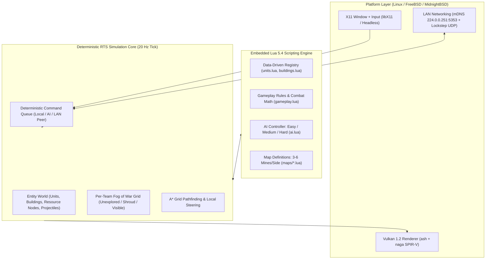

# Midnight Battle Zone — Implementation Plan

## Goal Description
Build **Midnight Battle Zone**, a cross-platform 3D real-time strategy (RTS) game written in **Rust** with **Vulkan** (`ash`) and **Lua 5.4** scripting that compiles and runs cleanly on **Linux**, **FreeBSD**, and **MidnightBSD**.

Key features include:
- **3D Angled Isometric Vulkan Renderer**: Procedural low-poly 3D **Cat** unit meshes (**Worker Cat**, **Soldier Cat**, **Sniper Cat** with pointy ears, tails, and role gear) and building meshes, terrain tiles, resource nodes, health/progress bars, selection rings, minimap, HUD command card, top-right **FPS & Time counter**, and a real-time **Fog of War** shader/visibility system.
- **AMD FidelityFX Super Resolution (FSR 1.0)**: Built-in Vulkan EASU (Edge-Adaptive Spatial Upsampling) + RCAS (Robust Contrast-Adaptive Sharpening) pass supporting `Native/Off`, `Ultra Quality (1.3x)`, `Quality (1.5x)`, `Balanced (1.7x)`, and `Performance (2.0x)` presets.
- **Synchronized Two-Player Pause**: Either player can pause or resume the game (`P` key or HUD Pause button), freezing simulation ticks for both players with an on-screen pause banner.
- **Cat Meow Task Audio & Callouts**: Worker Cats and Soldier Cats play synthesized cat meows (`"Meow!"` / `"Mrow!"`) and display floating speech callouts when assigned tasks.
- **Optional Jazz & Blues Background Music**: Includes built-in public-domain Jazz and Blues tracks (*St. Louis Blues [1914]*, *Midnight Cool Jazz*, and *12-Bar Blues Shuffle*) plus external audio file support, toggleable anytime (`J` key or HUD/Lobby selector).
- **SDL3 Gamepad & Steam Deck Support**: Dynamically loads `libSDL3` (`SDL_Gamepad` API) so controllers can move the cursor, box-select Cat units, pan/zoom the camera, construct buildings, and issue combat orders.
- **Economy & Base Building**:
  - **Command Center**: Base headquarters that trains **Worker Cats** and stores harvested resources.
  - **Resource Nodes & Mines**: Each map provides **3–6 resource nodes per player**. Worker Cats construct **Mines** on resource nodes and harvest resources from them.
  - **Houses**: Built by Worker Cats to increase unit population/supply capacity.
  - **Barracks**: Built by Worker Cats to train **Soldier Cats** (higher armor/HP, steady fire) and **Sniper Cats** (lower armor/HP, high-damage long-range rifle).
  - **Building Repair**: Worker Cats can repair damaged friendly buildings, consuming mined resources proportional to HP restored.
- **Victory Condition**: First player to destroy all buildings belonging to the opposing side wins.
- **Extensible Lua-Driven Architecture**: Unit definitions, building definitions, damage formulas, and the 3-tier AI (**Easy**, **Medium**, **Hard**) are scripted in Lua so new unit/building types and behaviors can be added without modifying engine internals.
- **Two-Player LAN Multiplayer**: Deterministic fixed-tick lockstep networking over UDP/TCP with both **Multicast DNS (mDNS)** auto-discovery (`224.0.0.251:5353`, `_mbz-rts._udp.local.`) and **Direct IP:Port** connection.

---

## Cross-Platform Portability Strategy (Linux, FreeBSD, MidnightBSD)

To guarantee clean builds across Linux, FreeBSD, and MidnightBSD:
1. **Vulkan**: Uses `ash` with runtime `dlopen` (`libvulkan.so.1` / `libvulkan.so`) and pure-Rust SPIR-V compilation via `naga` (no external `glslc` or C++ `shaderc` build dependency required).
2. **Windowing**: Uses a lightweight native X11 (`libX11` + `VK_KHR_xlib_surface`) windowing backend with automatic `/usr/local/lib` discovery on FreeBSD and MidnightBSD, plus a `--headless` mode for automated testing and server validation.
3. **Lua 5.4**: Bundled ANSI/POSIX C Lua 5.4 compiled via `cc` (`mlua` vendored feature), working identically across Linux, FreeBSD, and MidnightBSD.

---

## Architecture Overview

---

## Components & Modules

### Project Configuration & Cross-Platform Build System
- `Cargo.toml`: Configures package metadata and dependencies (`ash`, `naga`, `glam`, `mlua`, `serde`, `serde_json`, `libc`, `log`, `env_logger`, `rand`).
- `build.rs`: Detects target OS (`linux`, `freebsd`, `midnightbsd`), adds `/usr/local/lib` search path on FreeBSD/MidnightBSD, and links `X11`.

### Platform & Windowing Layer
- `src/platform/mod.rs` & `src/platform/x11.rs`: Direct `libX11` FFI bindings supporting Linux, FreeBSD, and MidnightBSD (`#[cfg(unix)]`), exposing `Display*` and `Window` handles for `VK_KHR_xlib_surface` creation via `ash::khr::xlib_surface`, plus a headless window mode.

### Vulkan 3D Renderer & Shaders
- `src/renderer/mod.rs`: Initializes Vulkan Instance, PhysicalDevice, Device, Swapchain, Depth Buffer, RenderPass, DescriptorSets, Fog of War texture, and Framebuffers using `ash`.
- `src/renderer/shaders.rs`: Uses `naga` to compile WGSL shaders into SPIR-V bytecode in pure Rust (3D lit world shader with Fog of War texture sampling + 2D HUD orthographic shader).
- `src/renderer/meshes.rs`: Procedural 3D low-poly mesh generator for terrain, obstacles, mineral crystal deposits, buildings (`command_center`, `house`, `mine`, `barracks`), units (`worker`, `soldier`, `sniper`), projectiles, selection rings, and bitmap font glyphs.
- `src/renderer/camera.rs`: 3D angled isometric camera (`pitch = -55°`, adjustable `yaw` & `zoom`), smooth panning, and screen-to-ground (`y = 0`) raycasting.

### Extensible ECS Simulation, Economy, Combat & Fog of War
- `src/sim/registry.rs`: Data-driven `UnitBlueprint` and `BuildingBlueprint` registries populated dynamically from Lua.
- `src/sim/world.rs`: Deterministic 20 Hz simulation handling mining, building construction, worker building repair (consuming mined resources), unit production, supply caps from Houses, armor/weapon combat math, and the building destruction victory condition.
- `src/sim/fog_of_war.rs`: Per-team visibility grid (`Unexplored`, `Explored`, `Visible`) enforcing both visual fog of war and targeting restrictions.
- `src/sim/pathfinding.rs`: Grid-based A* pathfinding and local unit separation steering.

### Embedded Lua 5.4 Engine, AI & Maps
- `src/scripting/lua_engine.rs`: Safe Rust bridge to Lua 5.4 for loading blueprints, maps, combat math, and executing AI ticks.
- `assets/scripts/units.lua`: Defines `worker`, `soldier`, and `sniper` blueprints (and supports adding new unit types in the future).
- `assets/scripts/buildings.lua`: Defines `command_center`, `house`, `mine`, and `barracks` blueprints.
- `assets/scripts/gameplay.lua`: Defines combat damage formula, repair resource consumption rate, starting resources, and victory condition hooks.
- `assets/scripts/ai.lua`: Implements Easy (`1`), Medium (`2`), and Hard (`3`) AI controllers.
- `assets/maps/midnight_valley.lua` (4 mines/side), `assets/maps/twin_iron_ridge.lua` (3 mines/side), `assets/maps/shattered_basin.lua` (6 mines/side).

### LAN Multiplayer & mDNS Discovery
- `src/net/mdns.rs`: RFC 6762 Multicast DNS (`224.0.0.251:5353`, `_mbz-rts._udp.local.`) with fallback LAN broadcast discovery.
- `src/net/lockstep.rs`: Deterministic 2-player lockstep networking over UDP supporting both mDNS discovered lobbies and direct `IP:Port` connections.

### User Interface, Input Controls & Main Loop
- `src/ui/hud.rs`: Main Menu / Lobby overlay and In-Game HUD (top resource/supply bar, interactive minimap, unit selection panel, and command card).
- `src/main.rs`: Main loop tying together CLI flags, windowing, Vulkan rendering, Lua scripting, AI, and LAN lockstep networking.
